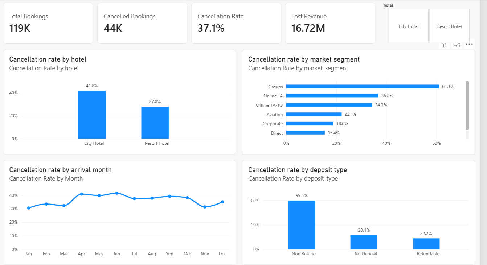
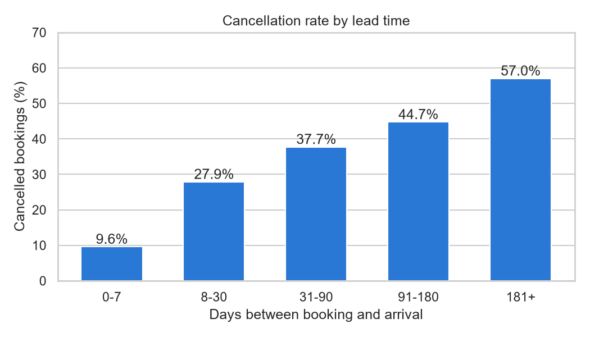
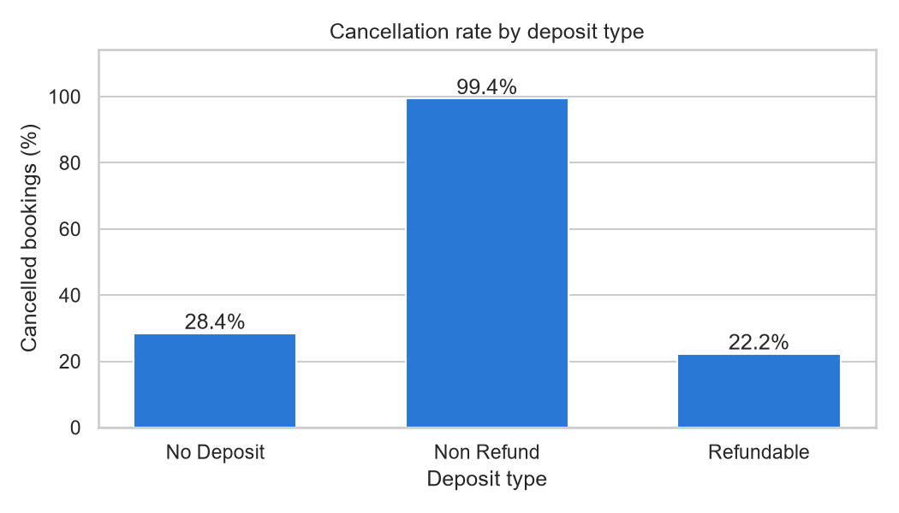
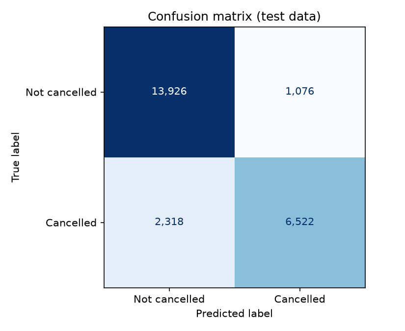
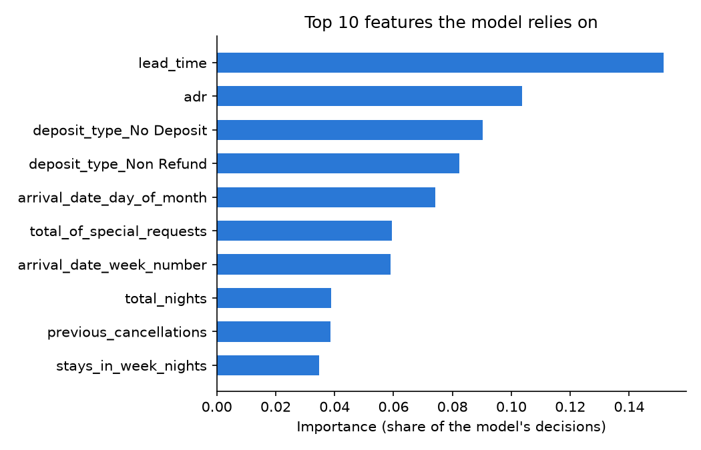
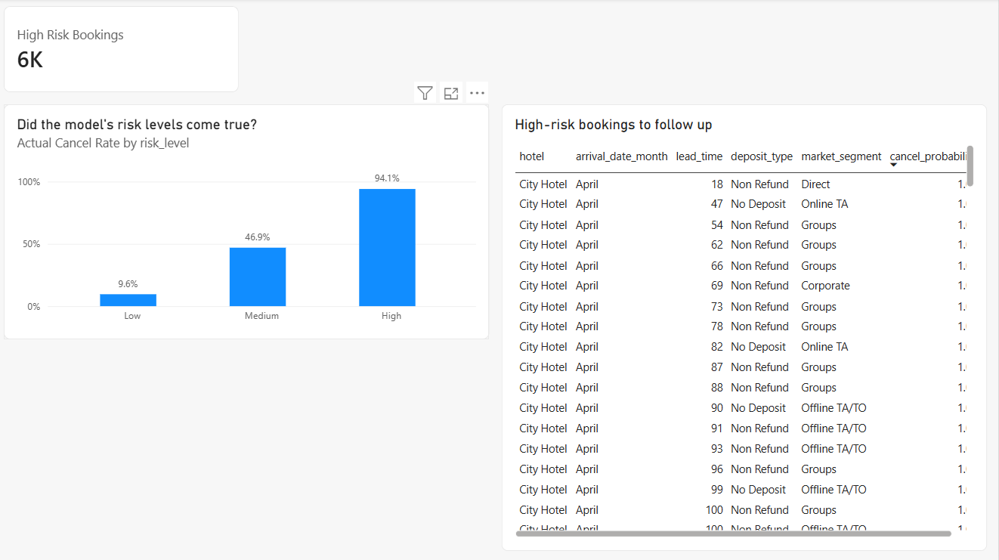

# 🏨 Hotel Booking Cancellation Prediction

End-to-end data analytics project: **SQL** analysis, **Python** exploratory analysis, a **machine learning** model and an interactive **Power BI** dashboard to explain and predict hotel booking cancellations.



## 📌 Business problem
**37% of bookings were cancelled**, costing an estimated **€16.7 million** in lost room revenue across two hotels (2015–2017). When a guest cancels, the room often stays empty.

**Goal:** find what drives cancellations and **predict which bookings are likely to cancel**, so the hotel can overbook safely, request deposits or send reminders.

## 🗂️ Dataset
- **Source:** [Hotel Booking Demand](https://www.kaggle.com/datasets/jessemostipak/hotel-booking-demand) on Kaggle, from the paper *"Hotel booking demand datasets"* (Antonio, Almeida & Nunes, *Data in Brief*, 2019)
- **Size:** 119,390 bookings × 32 columns, from a City Hotel and a Resort Hotel in Portugal (Jul 2015 – Aug 2017)
- **License:** CC BY 4.0

## 🛠️ Tools
| Area | Tools |
|---|---|
| Data analysis | Python (pandas, matplotlib, seaborn) in Jupyter notebooks |
| Database | SQL (SQLite, DB Browser for SQLite) |
| Machine learning | scikit-learn (Random Forest) |
| Dashboard | Power BI Desktop (DAX) |
| Version control | Git & GitHub |

## 🔍 Key findings
| # | Finding |
|---|---|
| 1 | **City Hotel** cancels far more (41.8%) than the **Resort Hotel** (27.8%) |
| 2 | **Lead time** is the strongest driver: 9.6% of last-minute bookings cancel vs **57%** of bookings made 6+ months ahead |
| 3 | **Non-refundable** bookings cancel **99.4%** of the time, traced to **group and travel-agent block bookings** |
| 4 | Guests with **special requests** cancel less than half as often (≤22% vs 47.8%) |
| 5 | **Repeat guests** cancel 14.7% vs 37.8% for new guests |
| 6 | Cancellations peak **April–October** and are lowest in winter |




## 🤖 Machine learning model
A **Random Forest** (100 trees) trained on 80% of bookings and tested on the unseen 20%. Only information **known at booking time** was used. Leakage-risk columns (`reservation_status`, `assigned_room_type`, parking, country) were removed.

| Metric | Score |
|---|---|
| Baseline (always guess "not cancelled") | 62.9% |
| **Accuracy** | **85.8%** |
| Precision (cancelled) | 0.86 |
| Recall (cancelled) | 0.74 |

**The risk levels hold up:** bookings the model rated **High risk** really cancelled **94.1%** of the time, vs **9.6%** for Low risk.




## 📊 Power BI dashboard
- **Overview page:** KPIs, a hotel slicer, and cancellation rate by hotel, market segment, month and deposit type
- **Booking Risk page:** the model's risk levels, proof they work, and a follow-up list of high-risk bookings



## 💡 Business recommendations
1. **Stricter terms for long-lead and group bookings:** require deposits or shorter free-cancellation windows for bookings made 90+ days ahead and for group / travel-agent blocks.
2. **Smart overbooking:** use the model's risk score to overbook only against high-risk bookings.
3. **Targeted reminders:** contact high-risk guests about 30 days before arrival to confirm.
4. **Encourage engagement:** invite guests to add preferences (room, extras) after booking. Engaged guests cancel less (worth testing, since correlation ≠ causation).
5. **Reward loyalty:** repeat guests cancel far less, so a loyalty programme could pay off.

## ⚠️ Limitations
- 32,238 identical rows were kept (no booking ID; group bookings look identical), which may make the test score slightly optimistic.
- Data covers only two hotels in Portugal (2015–2017), so results may not generalise.
- Lost revenue is an estimate; some cancelled rooms may have been re-sold.

## 📁 Project structure
```
├── data/            # raw dataset (cleaned files are generated by the notebooks)
├── notebooks/       # 01 overview → 02 cleaning → 03 EDA → 04 machine learning
├── sql/             # business questions in SQL
├── src/             # create_database.py (builds the SQLite database)
├── dashboard/       # Power BI file (.pbix)
├── images/          # charts and dashboard screenshots
└── requirements.txt # Python libraries
```

## ▶️ How to run
```bash
git clone https://github.com/Virajsoni137/hotel-booking-cancellation-prediction.git
cd hotel-booking-cancellation-prediction
python -m venv .venv
.venv\Scripts\activate
pip install -r requirements.txt
```
1. Run the notebooks in order: `01` → `02` → `03` → `04`
2. *(Optional)* Build the database with `python src/create_database.py`, then run `sql/business_questions.sql` in DB Browser for SQLite
3. Open `dashboard/hotel_cancellation_dashboard.pbix` in Power BI Desktop (if asked, point it to your local `data` folder)

## 👤 Author
**Viraj Soni**, final-year engineering student
GitHub: [@Virajsoni137](https://github.com/Virajsoni137)

*Data: Antonio, N., de Almeida, A., & Nunes, L. (2019). Hotel booking demand datasets. Data in Brief, 22, 41–49.*

📄 **[Read the full project report (PDF)](report/project_report.pdf)**